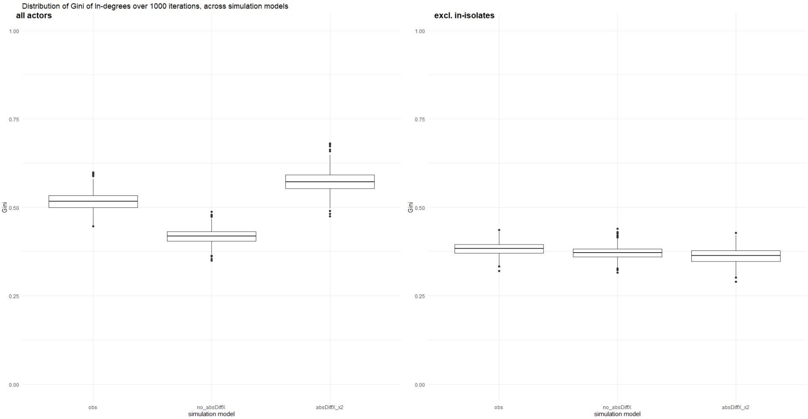
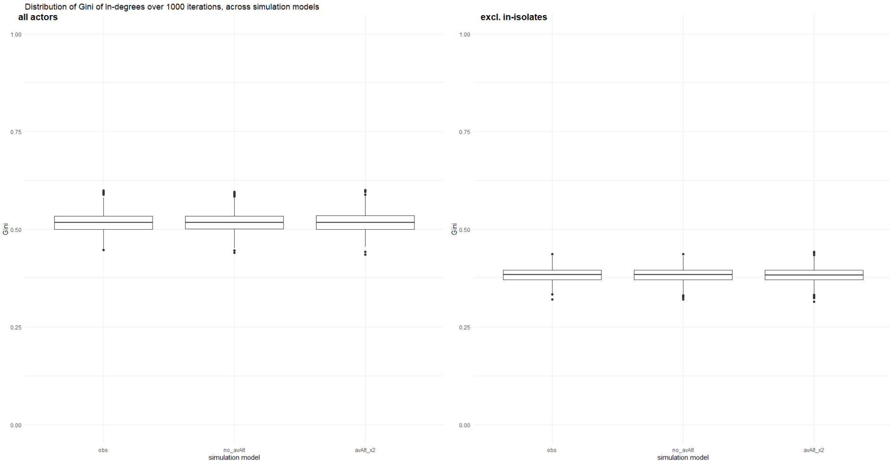
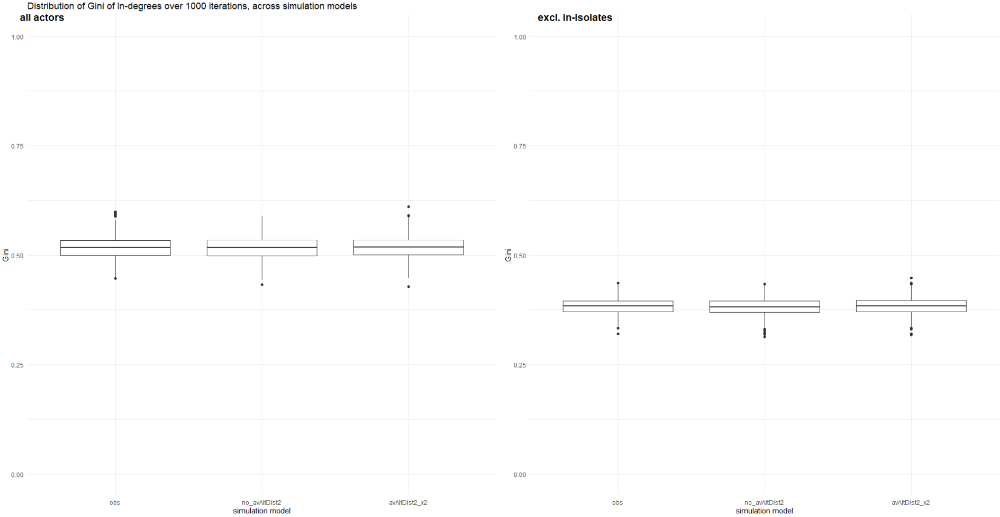

# Results

## Descriptive analyses

For the descriptive analyses, patterns in the networks of students in Michigan learning communities will be examined. Before calculating segregation measures, this paper will first look into some other descriptive statistics for the networks, to get a better feel for the data. To this end, this chapter starts with visualisations of the data, after which 'classic' network statistics will be calculated, for example about the density and reciprocity of the network. This all builds up to a better understanding of the final measure for segregation with regards to civic engagement, which will be used to answer RQ1.

```{r, echo=FALSE, include=TRUE}
klippy::klippy(position = c('top', 'right'))
klippy::klippy(color = 'purple')
klippy::klippy(tooltip_message = 'Click to copy', tooltip_success = 'Done')
```

```{r}
rm(list = ls())
load("./data/IndividualCharacteristics.RData")
load("./data/NetworkCharacteristics.RData")
load("./data/CivicAttitudes.RData")
```

```{r, warning=FALSE, echo=FALSE}
library(igraph)
library(network)
library(RSiena)
library(RsienaTwoStep)
library(ape)
library(sna)
library(tibble)
library(dplyr)
library(ggplot2)
library(ggpubr)
options(scipen = 5)
```

<br>

### Data visualisation

For the data visualisation, the variables were constructed as described in the 'data' chapter. However, additionally, the variable for civic attitudes was dichotomised, to create a clear distinction between people who hold neutral and people who hold positive attitudes. This allowed me to more easily spot potential clustering in the network. The cut-off point for neutral vs. positive attitudes was based on the mean score on the civic attitudes scale. For both waves, the average value was around 5, thus 5 was chosen as a cut-off point.

```{r}
hanging_df_t1 <- as.data.frame(hanging[[1]][1])
strong_netw_t1 <- data.matrix(hanging_df_t1)
strong_netw_t1[strong_netw_t1==9]<-NA

hanging_df_t2 <- as.data.frame(hanging[[1]][2])
strong_netw_t2 <- data.matrix(hanging_df_t2)
strong_netw_t2[strong_netw_t2==9]<-NA

IC_df <- as.data.frame(T1civeng[[1]])
IC_df$missings <- rowSums(is.na(IC_df))
IC_df$ce_t1 <- ifelse(IC_df$missings <= 1, rowMeans(IC_df[,1:4]), NA)

IC_df2 <- as.data.frame(T2civeng[[1]])
IC_df2$missings <- rowSums(is.na(IC_df2))
IC_df2$ce_t2 <- ifelse(IC_df2$missings <= 1, rowMeans(IC_df2[,1:4]), NA)

```

```{r}
IC_df$ce_t1_cat <- cut(IC_df$ce_t1,
                       breaks = c(0, 5, 7),
                       labels= c('neutral', 'positive'))
IC_df2$ce_t2_cat <- cut(IC_df2$ce_t2,
                        breaks = c(0, 5, 7),
                        labels= c('neutral', 'positive'))
```

For the data visualisation, the R-package igraph was used, in combination with the base-function 'plot'. As the data contained information on directed relationships, these were modeled as such. For both graphs, the position of the nodes were kept stable, to show the changes in ties. To accomplish this, the Davidson-Harel layout algorithm was used. This algorithm puts closely connected nodes close to each other, while pushing the lesser connected nodes to the outside [@stulp]. Importantly, this algorithm does keep isolated nodes within the network, rather than creating a ring outside of it. As I used the same layout for both Wave 1 and Wave 2, this ensured that there are no unreasonably long ties, when isolates in Wave 1 get ties in Wave 2. This algorithm also minimises the amount of overlap between the nodes. Furthermore, the graphs represent nodes with neutral attitudes as 'pink' and people with positive attitudes as 'purple.' Lastly, the size of the nodes is dependent on density. This was done to examine whether people with more positive attitudes may have more ties than others.

```{r}
copy_strong_netw_t1 <- strong_netw_t1
copy_strong_netw_t1[is.na(copy_strong_netw_t1)] <- 0 

g_strong_t1 <- igraph:: graph_from_adjacency_matrix(copy_strong_netw_t1, mode = "directed")
graph_CE_t1 <- simplify(g_strong_t1)
```

```{r, eval=FALSE}
layout <- igraph:: layout_with_dh(graph_CE_t1)
```

```{r, include=FALSE}
# saveRDS(layout, "layout.rds")
layout <- readRDS("layout.rds")
```

Figure 4 shows the visualisation of the network in Wave 1. Visually, the network does not seem very segregated with regards to civic attitudes, as the pink and purple nodes are mixed throughout the network. There are no clear clusters of only (or mostly) pink nodes or only (or mostly) purple nodes. This is an indication that people do not tend to interact with others with similar civic attitudes. This graph also showcases the betweenness of the different nodes. Most nodes with a relatively high betweenness (bigger node size) have neutral civic attitudes, with one exception, where the node with the highest betweenness has positive civic attitudes.

<br>

**Figure 4.**

*Visualisation of the network of a Michigan learning community in Wave 1*

```{r}
colour <- ifelse(IC_df$ce_t1_cat=='neutral', "lightpink", "orchid4")
V(graph_CE_t1)$size = igraph:: betweenness(graph_CE_t1, normalized = T, directed = T) * 50 + 5
plot_CE_t1 <- plot(graph_CE_t1,
                   vertex.color = colour,
                   vertex.frame.color = "gray",
                   edge.curved = 0.2, 
                   edge.arrow.size = 0.1,
                   vertex.label = NA,
                   layout = layout)
legend("topleft", c("neutral", "positive", "missing"), pch = 21, col = "#777777", pt.bg = c("lightpink", "orchid4", "white"), pt.cex = 2,
       cex = 0.8, bty = "n", ncol = 1)
```

<br>

```{r}
copy_strong_netw_t2 <- strong_netw_t2
copy_strong_netw_t2[is.na(copy_strong_netw_t2)] <- 0 

g_strong_t2 <- igraph:: graph_from_adjacency_matrix(copy_strong_netw_t2, mode = "directed")
graph_CE_t2 <- simplify(g_strong_t2)
```

Figure 5 shows the same network, but a few months later in Wave 2. Seemingly, the density has decreased between Wave 1 and Wave 2, as the amount of ties has visually decreased, and the amount of nodes with a high degree of betweenness has also decreased, because there are fewer big nodes. With regards to the degree of segregation of civic attitudes, Wave 2 may give the indication of a slightly higher degree of segregation, with small 'clusters' of purple appearing in the middle left and bottom right. However, this is not immediately apparent, and the network seems to be mostly very mixed with regards to civic attitudes. Especially the cluster on the bottom right is dubious, as the nodes' attitudes have remained the same between Waves 1 and 2, the only thing that has changed is that nodes who were neutral in Wave 1, did not have a valid score in Wave 2. This can therefore not be seen as proof of segregation.

<br>

**Figure 5.**

*Visualisation of the network of a Michigan learning community in Wave 2*

```{r}
colour <- ifelse(IC_df2$ce_t2_cat=='neutral', "lightpink", "orchid4")
V(graph_CE_t2)$size = igraph:: betweenness(graph_CE_t2, normalized = T, directed = T) * 50 + 5
plot_CE_t2 <- plot(graph_CE_t2,
                   vertex.color = colour,
                   vertex.frame.color = "gray",
                   edge.curved = 0.2, 
                   edge.arrow.size = 0.1,
                   vertex.label = NA,
                   layout = layout)
legend("topleft", c("neutral", "positive", "missing"), pch = 21, col = "#777777", pt.bg = c("lightpink", "orchid4", "white"), pt.cex = 2,
       cex = 0.8, bty = "n", ncol = 1)
```

<br>

Comparing the two graphs does not immediately indicate a clear conclusion with regards to the degree of segregation in the networks. However, there do seem to be changes in the network. To further clarify these changes, and the network composition, I will be reporting on numeric descriptions of the networks below.

<br>

### Numeric descriptions

#### Nodes and ties

In both Wave 1 and Wave 2 121 students were included in the network. In Wave 1 there were a total of 395 directed ties, and in Wave 2 this was 270. Thus, the amount of ties decreased between the two waves, making the network sparser.

```{r}
# Wave 1
g_strong_t1 <- igraph:: graph_from_adjacency_matrix(copy_strong_netw_t1, mode = "directed")
vcount(g_strong_t1)
ecount(g_strong_t1)

# Wave 2
g_strong_t2 <- igraph:: graph_from_adjacency_matrix(copy_strong_netw_t2, mode = "directed")
vcount(g_strong_t2)
ecount(g_strong_t2)

```

<br>

#### Density

As shown above, the networks in both Wave 1 and Wave 2 seem relatively sparse. This is also reflected when calculating their density. To calculate the density of a network, the function "as.network" from the network package was used. This function automatically replaces all missing values with 0, meaning that everyone who did not answer the question about who they hang out with, is seen as having no out-going ties. Concretely, the density of the network shows how many of the possible network ties are actually realised in a network [@SNASS]. Thus, a density of 1, means that 100% of all possible ties are actually made, where a density of 0 means that 0% of all possible ties are observered. For the networks in the Michigan learning community the density was .027 and .019, in Wave 1 and Wave 2 respectively. Thus, only 2.7% of all possible ties were actually present in Wave 1, which decreased even further in Wave 2, to only 1.9%. This is a very low density for network, especially when comparing it to friendship networks in classrooms, which are usually between .2 and .4 [@SNASS]. Of course, a Michigan learning community is not the same as classroom, as an average classroom is smaller than the learning community, and the students in Michigan do not take all their classes together. However, even comparing the Michigan learning community to a small world network shows that the learning community has a very low density.

```{r}
# Wave 1
netw1 <- network:: as.network(strong_netw_t1)
network:: network.density(netw1)
# 0.02720386

# Wave 2
netw2 <- network:: as.network(strong_netw_t2)
network:: network.density(netw2)
# 0.01859504
```

<br>

#### In and out degree

To calculate the in- and outdegree of the nodes in the network, the package igraph was used. In Wave 1, students, on average, received 3.264 friendship nominations, however, most students received 3. The most popular node received 13 ties. As it is a closed network, the average received ties, is also the average sent ties. Thus the average for indegree is the same as the average for outdegree. However, most people sent just 2 outgoing friendship nominations, with a maximum of 10 nominations. This maximum was established beforehand, rather than reflecting the full scope of people's friendship networks.

For Wave 2, as expected based on the density, the mean in- and outdegree decreased to 2.231, with a median of 2 for both as well. The most popular node got nominated 10 times, and the node with the most outdegrees nominated 9 others. Thus, comparing Wave 1 and 2, both the indegrees and the outdegrees have decreased, indicating a sparser network.

```{r}
# Wave 1
indeg <- igraph::degree(g_strong_t1, mode = "in")
summary(indeg)

outdeg <- igraph::degree(g_strong_t1, mode = "out")
summary(outdeg)

# Wave 2
indeg <- igraph::degree(g_strong_t2, mode = "in")
summary(indeg)

outdeg <- igraph::degree(g_strong_t2, mode = "out")
summary(outdeg)
```

<br>

#### Reciprocity

Furthermore, I calculated the reciprocity of the network. This was done by using the "reciprocity" function in the igraph package. This function calculates the probability of an out-going tie from ego being returned by alter. Similar to density, a value of 1 for reciprocity means that 100% of all out-going ties are reciprocated, and a value of 0 means that none of the out-going ties are met with in-coming ties. The reciprocity in Wave 1 for the Michigan learning community is .471 and in Wave 2 this is .444. This means that, overall, about 45% of all out-going ties are reciprocated. As this paper looks into friendship networks, by asking who people hang out with, it makes sense that a large portion of the ties are reciprocated. If ego hangs out with alter, alter also hangs out with ego. However, more than half of the ties are not reciprocated, which can mean that ego and alter have different ideas about who they hang out with, or what the threshold is for nominating someone as a friend. The reciprocity measure will be slightly skewed by replacing the missing values with 0, as all in-coming ties for those ego's are automatically not reciprocated, even if in reality they may be.

```{r}
# Wave 1
reciprocity(g_strong_t1, ignore.loops = TRUE, mode = c("default", "ratio"))
# 0.4708861

# Wave 2
g_strong_t2 <- igraph:: graph_from_adjacency_matrix(copy_strong_netw_t2, mode = "directed")
reciprocity(g_strong_t2, ignore.loops = TRUE, mode = c("default", "ratio"))
# 0.4444444
```

<br>

#### Path length and average reach

To gain further insight into potential clustering of civic attitudes in the networks, I calculated the average path length and average reach for both Wave 1 and Wave 2. Average shortest path length refers to the the average lowest number of steps for all pairs of nodes in a network [@SNASS]. Concretely, what this means is that for every node the shortest path (through the least other nodes) is calculated for every other node. In these calculations, only connected nodes are taken into account, as isolates cannot be reached. The average for all nodes is then calculated. In Wave 1, the average shortest path is 4.841, meaning that the average connected ego has to go through 4.841 nodes to get to every other alter. This number slightly decreases in Wave 2, leading to an average of 4.592. Thus, connected nodes have to go through slightly fewer other nodes to reach every other alter.

Based on this average shortest path length, the average reach was calculated. This measure indicates what degree of other nodes ego can reach within the network, through the existing ties [@SNASS]. This number is then averaged for all nodes in a network. In Wave 1, the average reach was .218%, meaning that the average node can reach .218% of other nodes. Again, this number decreases for Wave 2, to .171%.

Combining the decreasing average path length with the decreasing density, indicates that there are more isolates in Wave 2, as the amount of ties decreases, while the nodes that are connected can more easily reach each other. This is also reflected in the average reach, as this decreases between Wave 1 and 2. As isolates have an average reach of 0, an increase in isolates will also lead to a lower average reach.

```{r}
# Wave 1
print(mean_dis <- mean_distance(g_strong_t1))
# 4.840779
mean((ego_size(g_strong_t1, order = mean_dis, mode = "out") - 1)/vcount(g_strong_t1))
# 0.2180862

# Wave 2
print(mean_dis <- mean_distance(g_strong_t2))
# 4.591732
mean((ego_size(g_strong_t2, order = 7, mode = "out") - 1)/vcount(g_strong_t2))
# 0.1705485
```

<br>

#### Segregation

Finally, after gaining more insight in the networks, I calculated Moran's I segregation index. As was to be expected based on visual inspection, there is not much segregation in the network. I calculated Moran's I using the ape package, which automatically row standardises. This means that the calculation assumes that each node is influenced equally by its neighbourhood, regardless of how large its neighbourhood is [@SNASS]. Thus, it is tested whether nodes are similar to the average of their neighbours. As there is no clear segregation in the network, I went through a few steps to see whether there is *any* degree of segregation.

Firstly, I just looked at segregation based on direct ties. This returned the expected result: Neither in Wave 1 nor in Wave 2 is there evidence of segregation. In Wave 1, Moran's I is -0.014 (*p* = 0.942) and in Wave 2 it is -0.018 (*p* = 0.917). This means that the observed network does not differ significantly from the expected network, when there is no segregation. In fact, for both waves the observed and expected networks get very similar values, indicating that civic attitudes are spread throughout the network, rather than being clustered.

```{r}
# Wave 1
geodistances <- geodist(netw1, count.paths = TRUE)
geodistances <- geodistances$gdist

weights1 <- geodistances == 1
ape::Moran.I(IC_df$ce_t1, scaled = FALSE, weight = weights1, na.rm = TRUE)

# Wave 2
geodistances <- geodist(netw2, count.paths = TRUE)
geodistances <- geodistances$gdist

weights1 <- geodistances == 1
ape::Moran.I(IC_df2$ce_t2, scaled = FALSE, weight = weights1, na.rm = TRUE)
```

<br>

Thus, when looking at students' direct networks there is no segregation with regards to civic attitudes. However, it is possible that there is some degree of segregation when taking indirect ties into account. I calculated Moran's I again, this time using a decaying weigh function, which takes into account the path length to reach another node. The further the path length, the less weight is placed on that alter. When looking at the segregation within indirect networks, there is an indication of segregation. In Wave 1 Moran's I is .329, which significantly deviates from the expected network without any segregation (*p* \< .001). Moran's I also significantly deviates from the expected network in Wave 2, with a value of .531 (*p* \<.001).

Comparing the results from Moran's I based on direct ties, and based on a decaying weight function shows an interesting pattern. When solely taking direct ties into account, there does not seem to be segregation. However, when taking ties at a further distance into account, while still weighing the direct ties the most strongly, there is segregation with regards to civic attitudes. Seemingly, nodes are not necessarily more similar to their direct ties, but they are more similar to their indirect ties. This disparity in significance could also be due to differences in power, however the coefficients are substantially different, indicating that there is something going on in the data.

```{r}
# Wave 1
geodistances <- geodist(netw1, count.paths = TRUE)
geodistances <- geodistances$gdist

weights2 <- exp(-geodistances)
ape::Moran.I(IC_df$ce_t1, scaled = FALSE, weight = weights2, na.rm = TRUE)

# Wave 2
geodistances <- geodist(netw2, count.paths = TRUE)
geodistances <- geodistances$gdist

weights2 <- exp(-geodistances)
ape::Moran.I(IC_df2$ce_t2, scaled = FALSE, weight = weights2, na.rm = TRUE)
```

<br>

These results do not support Hypothesis 1, as I expected there to be segregation with regards to direct ties. However, despite the limited amount of segregation in both waves, there is some indication of either preference or influence in broader, indirect networks. The network also changed visibly between Wave 1 and Wave 2, with new ties being created, and existing ties being broken. Therefore, there is some indication that micro-processes based on civic attitudes can have taken place, without them being visible on a macro, descriptive, scale.

<br>

## Exploratory analyses

In the following section I will be looking into whether there are influence and selection effects with regards to civic attitudes within the network, which could explain the changes between Wave 1 and Wave 2. To examine this, I will be using RSiena [@ripley2026]and building my model iteratively. To start I will be describing the null-model (Model 1), where I do not add any additional statistics to my RSiena model. This model will be expanded based on theoretical considerations in Model 2, to test whether there are selection effects with regards to civic attitudes. In Model 3, I will add the statistics to test for influence effects. After building my theoretical model, I will use Goodness of Fit (GoF) measures, to improve how well the model can predict the actual observations. Before describing the models, I will firstly show how I prepared my variables for analysis.

<br>

### Data preparation

```{r}
# Starting with a clean workspace
rm(list = ls())
load("./data/IndividualCharacteristics.RData")
load("./data/NetworkCharacteristics.RData")
load("./data/CivicAttitudes.RData")
```

```{r}
#Create network matrices
hanging_df_t1 <- as.data.frame(hanging[[1]][1])
strong_netw_t1 <- data.matrix(hanging_df_t1)
strong_netw_t1[strong_netw_t1==9]<-NA

hanging_df_t2 <- as.data.frame(hanging[[1]][2])
strong_netw_t2 <- data.matrix(hanging_df_t2)
strong_netw_t2[strong_netw_t2==9]<-NA
```

```{r}
# Make civic attitudes scale
IC_df <- as.data.frame(T1civeng[[1]])
IC_df$missings <- rowSums(is.na(IC_df))
IC_df$ce_t1 <- ifelse(IC_df$missings <= 1, rowMeans(IC_df[,1:4]), NA)

IC_df2 <- as.data.frame(T2civeng[[1]])
IC_df2$missings <- rowSums(is.na(IC_df2))
IC_df2$ce_t2 <- ifelse(IC_df2$missings <= 1, rowMeans(IC_df2[,1:4]), NA)

# Put civic attitudes in matrix
IC_df <- IC_df %>% 
  rownames_to_column(var = "id") 
IC_df2 <- IC_df2 %>% 
  rownames_to_column(var = "id") 
IC_df <- left_join(IC_df, IC_df2, by=c("id"))
behy <- IC_df %>% 
  dplyr::select("ce_t1", "ce_t2") %>% 
  as.matrix()
```

```{r}
# Make gender variable (independent variable)
gender1 <- gender[[1]][,1]
gender2 <- gender[[1]][,2]
gender <- coalesce(gender1, gender2)
```

```{r}
# Create Siena dependent variables
# Network
nety <- sienaDependent(array(data= c(strong_netw_t1, strong_netw_t2), dim=c(dim(strong_netw_t1),2)))

# Civic attitudes
behy <- sienaDependent(behy, type = c("behavior"))


# Create Siena covariate
# Gender
gender_covar <- coCovar(gender)
```

```{r}
# Create Siena dataframe
mydata <- sienaDataCreate(nety, gender_covar, behy)

# Create algorithm
myAlgorithm <- sienaAlgorithmCreate(projname = "civic_attitudes", MaxDegree = c(nety = 10))

# Create effect (with no additional effects)
myeff <- getEffects(mydata)
```

<br>

### Model 1: Null model

The following model only includes density and reciprocity, as network statistics and the behavioural evolution as a linear and quadratic shape, as these are automatically included when running an RSiena model.

```{r, eval=FALSE}
model_1 <- siena07(myAlgorithm, data = mydata, effects = myeff, returnDeps = TRUE)
```

```{r, include = FALSE}
# saveRDS(model_1, "model_1.rds")
model_1 <- readRDS("model_1.rds")
```

```{r}
# Model results
model_1

# Significance
results_model1 <- data.frame(
  effect = model_1$effects$effectName,
  b = model_1$theta,
  se = model_1$se,
  t = model_1$theta / model_1$se,
  p = 2 * pnorm(-abs(model_1$theta / model_1$se)))

pander:: pander(results_model1)
```

<br>

The results show that this model converges well, as the overall maximum convergence ratio (.103) is smaller than .25, and all the convergence t-ratio's are smaller than .1. As this is the simplest possible model, it makes sense that it converges well.

For the network dynamics the simple model shows that the network is not very dense, which matches with the findings in the descriptive section. There is a significant outdegree effect (*b* = -2.627, *SE* =.081), meaning that the chances of observing an outgoing tie are significantly lower than observing an incoming tie. Overall, nodes create relatively few ties with others. When a tie is formed, it is likely to be reciprocated, as is evident from the value for reciprocity, which is positive and significant (*b* = 2.204, *SE* = .178).

As for behaviour, the simple model does not find a significant linear effect (*b* = .177, *SE* = .103). This means that nodes do not linearly converge to the mean. When ego changes their civic attitudes they do not move towards the group-mean in a linear way. Model 1 does find the quadratic shape to be significant (*b* = -.281, *SE* = .074). This means that nodes' evaluation score for going up or down on civic attitudes follows a quadratic shape.

<br>

### Model 2: Selection effects

For Model 2 I will add effects to test whether there are influence effects with regards to civic attitudes. Here I also added a covariate for gender, as it can be expected that gender and civic attitudes correlate. Thus, this model should show whether there are any influence effects happening, where nodes become more similar to their ties, with regards to civic attitudes.

```{r}
myeff_model2 <- includeEffects(myeff, sameX, interaction1 = "gender_covar")

myeff_model2 <- includeEffects(myeff_model2, egoX, altX, absDiffX, interaction1 = "behy")
```

```{r, eval=FALSE}
model_2 <- siena07(myAlgorithm, data = mydata, effects = myeff_model2, returnDeps = TRUE)
```

```{r, include = FALSE}
# saveRDS(model_2, "model_2.rds")
model_2 <- readRDS("model_2.rds")
```

```{r}
# Model results
model_2

# Significance
results_model2 <- data.frame(
  effect = model_2$effects$effectName,
  b = model_2$theta,
  se = model_2$se,
  t = model_2$theta / model_2$se,
  p = 2 * pnorm(-abs(model_2$theta / model_2$se)))

pander:: pander(results_model2)
```

<br>

Again the model converges adequately, with an overall maximum convergence ratio of .122, and a maximum convergence t-ratio of -.076. The direction and the significance of the statistics included in the null-model remain the same when adding gender as a covariate and adding influence effects to the model.

For the gender covariate, the statistic "sameX" was added to the model. In a previous test-model both egoX and altX were also added, as these underlie the sameX statistic, however, neither of those were significant, thus adding them for the final model was not deemed necessary. The sameX effect shows whether ego is connected to others with the same value on X, in this case the covariate. Thus, it shows whether people are more likely to have a tie to someone else with the same gender identity. This statistic is significant in Model 2 (*b* = .319, *SE* = 125). The positive coefficient indicates that node *i* would be more likely to make a tie with node *j* compared to node *h*, if *i* and *j* have the same gender identity, and *i* and *h* differ in their gender identity.

As for the selection effects with regards to civic attitudes, none of the included statistics were significant. This means that the likelihood of sending (egoX, *b* = -.259, *SE* = .151) or receiving (altX, *b* = -.69, *SE* = .130) a tie is not dependent on ego's civic attitudes. To test whether nodes are more likely to send ties to others with similar civic attitudes, the statistic "absDiffX" was used. This is a statistic that measures how much two nodes differ in their civic attitudes. The more two nodes differ, the worse a relationship is evaluated, making the chances of making of maintaining a tie with a similar other more likely. This statistic was also insignificant (*b* = -.227, *SE* = .214). Thus, there does not seem to be a selection effect for civic attitudes.

<br>

### Model 3: Influence effects

For Model 3, I added statistics that measure the influence effects. In this model I chose not to include egoX and altX effects for the selection effects, as Model 2 showed these to be insignificant. They, therefore, would not add to the fit of the model. AbsDiffx was kept in the model, as it is a relevant statistic for testing Hypothesis 2. The covariate for gender was added again.

```{r}
myeff_model3 <- includeEffects(myeff, sameX, interaction1 = "gender_covar")

myeff_model3 <- includeEffects(myeff_model3, absDiffX, interaction1 = "behy")

myeff_model3 <- includeEffects(myeff_model3, name = "behy", avAlt, avAltDist2, interaction1 = "nety")

myeff_model3 <- includeEffects(myeff_model3, name = "behy", indeg, outdeg, interaction1 = "nety")
```

```{r, eval=FALSE}
model_3 <- siena07(myAlgorithm, data = mydata, effects = myeff_model3, returnDeps = TRUE)
```

```{r, include = FALSE}
# saveRDS(model_3, "model_3.rds")
model_3 <- readRDS("model_3.rds")
```

```{r}
# Model results
model_3

# Significance
results_model3 <- data.frame(
  effect = model_3$effects$effectName,
  b = model_3$theta,
  se = model_3$se,
  t = model_3$theta / model_3$se,
  p = 2 * pnorm(-abs(model_3$theta / model_3$se)))

pander:: pander(results_model3)
```

<br>

The maximum convergence ratio is sufficient with .148, and the highest convergence t-ratio is .083. The direction and significance of the outdegree, reciprocity, same gender and quadratic shape remain stable. As opposed to Model 2, the absDiffx statistic is significant (*b* = -.344, *SE* = .204). Thus, when controlling for influence effects, nodes do tend to make and keep ties with people who are similar to them on civic , attitudes. Therefore, there seems to be a selection effect on civic attitudes when choosing who to befriend.

To measure influence effects of civic attitudes four measures were added. Firstly, I looked at the indegree effect, or whether ego becomes more similar to alter when alter has sent a tie to ego. This effect is not significant (*b* = .032, *SE* = .142). Secondly, the outdegree effect is also not significant (*b* = -.020, *SE* = .108), meaning that ego also does not become more similar to alter when ego has nominated alter as a friend. Third, I looked at the average alter effect, which examines whether people become more similar in their civic attitudes to the mean of the sample. This is also not found (b= -.301, *SE* = 1.058). Lastly, an average alter effect was added for alters at a distance 2. This was done, as Moran's I indicated that there is more segregation when taking people's indirect ties into account. This, however, was also not found to be significant (*b* = .549, *SE* = 2.201). Thus, there does not seem to be an influence effect, rejecting Hypothesis 2.

<br>

#### Goodness of Fit

Theoretically speaking, I have now added all the statistics that are of interest for me to answer my research question and test my hypothesis. However, it is unclear how well my model actually predicts the data. To that end, I will be performing a GoF, and if necessary adjusting my Model by adding more statistics/ deleting insignificant ones.

```{r}
gof_indeg_model3 <- RSiena::sienaGOF(model_3, IndegreeDistribution, verbose = FALSE, join = TRUE, varName = "nety")

gof_outdeg_model3 <- RSiena:: sienaGOF(model_3, OutdegreeDistribution, verbose = FALSE, join = TRUE, levls = c(0:10, 15, 20), varName = "nety")

gof_triad_model3 <- sienaGOF(model_3, TriadCensus, verbose = FALSE, join = TRUE, varName = "nety")
```

#### Plots {.tabset .tabset-fade}

##### Indegree distribution

```{r}
plot(gof_indeg_model3)
```

##### Outdegree distribution

```{r}
plot(gof_outdeg_model3)
```

##### Triad census

```{r}
plot(gof_triad_model3, center=TRUE, scale=TRUE)
```

####  {.unlisted .unnumbered}

<br>

The graph for GoF indicates how well the model reflects the observed data. It tests whether the model's predication deviate significantly from the observations. For Model 3, the GoF for the indegree looks good, there is no significant difference between the Model's predictions and the observered data. This means that Model 3 can accurately predict how the indegree distribution works in the network of students in a Michigan learning community.

There are significant deviations for the outdegree and the triad census. This is also visually apparent, as the red dots (the observed values) lay outside or on the edge of the boxplots. For the outdegree distribution, Model 3 struggles especially to predict how many nodes there are with zero out going ties. The triad census tests for which triad configurations the model accurately predicts how often they exist in the network. For most triad configurations Model 3 is an accurate prediction, however, for a few the model deviates a lot. This is especially evident for triads 030T and 120U, where the observed value lies way beyond the predicted values. 030C is a triad in which every node has a tie with the person on their right (or left), it is thus a circular pattern. This configuration is relatively common in the observed networks. This is an interesting pattern, as there are no reciprocated ties, despite all nodes filling out the question (they all have outgoing ties). Triad configuration 120U is a triad in which two nodes have a reciprocated tie, and these ties both have an outgoing tie to the same, other, node. This third node does not have any outgoing ties. Again, this configuration occurs more in the observations than in the predictions. This configuration could be explained by people who did not fill out the question on hanging out, as they would not have any outgoing ties.

To improve the GoF, I will first be focusing on the triad census. By adding a statistic that explicitly takes triads into account, I hope to improve the fit.

<br>

### Model 4: Triads

For improving the model fit with regards to the triad census, I will be adding the GWESP statistic. Specifically, I will be adding "gwespFF," as a measure for transitivity. Secondly, I will be removing the behavioural in- and outdegree, as these were not significant, and are potentially captured with the average alter measures.

```{r}
myeff_model4 <- includeEffects(myeff, sameX, interaction1 = "gender_covar")

myeff_model4 <- includeEffects(myeff_model4, absDiffX, interaction1 = "behy")

myeff_model4 <- includeEffects(myeff_model4, name = "behy", avAlt, avAltDist2, interaction1 = "nety")

myeff_model4 <- includeEffects(myeff_model4, gwespFF)
```

```{r, eval=FALSE}
model_4 <- siena07(myAlgorithm, data = mydata, effects = myeff_model4, thetaBound = 10000, returnDeps = TRUE)
```

```{r, include = FALSE}
# saveRDS(model_4, "model_4.rds")
model_4 <- readRDS("model_4.rds")
```

```{r}
# Model results
model_4

# Significance
results_model4 <- data.frame(
  effect = model_4$effects$effectName,
  b = model_4$theta,
  se = model_4$se,
  t = model_4$theta / model_4$se,
  p = 2 * pnorm(-abs(model_4$theta / model_4$se)))

pander::pander(results_model4)
```

<br>

The model converged well (.151), with a maximum convergence t-ratio of -.084. Most statistics remain stable between Model 3 and Model 4, only the behavioural quadratic shape is not significant anymore (*b* = -.298, *SE* = .141). The added statistic gwespFF is significant, meaning that *i* and *j* having common friends significantly affects the probability that *i* and *j* will create a tie as well.

<br>

#### Goodness of Fit

```{r}
gof_indeg_model4 <- RSiena::sienaGOF(model_4, IndegreeDistribution, verbose = FALSE, join = TRUE, varName = "nety")

gof_outdeg_model4 <- RSiena:: sienaGOF(model_4, OutdegreeDistribution, verbose = FALSE, join = TRUE, levls = c(0:10, 15, 20), varName = "nety")

gof_triad_model4 <- sienaGOF(model_4, TriadCensus, verbose = FALSE, join = TRUE, varName = "nety")
```

#### Plots {.tabset .tabset-fade}

##### Indegree distribution

```{r}
plot(gof_indeg_model4)
```

##### Outdegree distribution

```{r}
plot(gof_outdeg_model4)
```

##### Triad census

```{r}
plot(gof_triad_model4, center=TRUE, scale=TRUE)
```

####  {.unlisted .unnumbered}

<br>

The GoF for the indegree distribution remains adequate. The GoF for both the outdegree distribution and the triad census has improved by adding the "gwespFF" statistic, however, for both the model still deviates significantly from the observed values. For both it is also the case that none of the observed values fall completely outside of the predicted values anymore.

The next step in improving the model fit will be adding a statistic for isolates, as this is something the model still struggles to predict. As is evident from the outdegree distribution, the prediction of zero outdegrees is lower than the observed.

<br>

### Model 5: Isolates

To account for the isolates I added the "outIso" statistic. This statistic should take into account the desire for nodes to have no outgoing ties.

```{r}
myeff_model5 <- includeEffects(myeff, sameX, interaction1 = "gender_covar")

myeff_model5 <- includeEffects(myeff_model5, absDiffX, interaction1 = "behy")

myeff_model5 <- includeEffects(myeff_model5, name = "behy", avAlt, avAltDist2, interaction1 = "nety")

myeff_model5 <- includeEffects(myeff_model5, gwespFF)

myeff_model5 <- includeEffects(myeff_model5, outIso)
```

```{r, eval=FALSE}
model_5 <- siena07(myAlgorithm, data = mydata, effects = myeff_model5, thetaBound = 10000, returnDeps = TRUE)
```

```{r, include = FALSE}
# saveRDS(model_5, "model_5.rds")
model_5 <- readRDS("model_5.rds")
```

```{r}
# Model results
model_5

# Significance
results_model5 <- data.frame(
  effect = model_5$effects$effectName,
  b = model_5$theta,
  se = model_5$se,
  t = model_5$theta / model_4$se,
  p = 2 * pnorm(-abs(model_5$theta / model_5$se)))

pander:: pander(results_model5)
```

The model convergence is still satisfactory (.151), and the maximum convergence t-ratio is -.089. The basic rate parameter, density, reciprocity, GWESP and same gender remain significant, however, interestingly, the measure for behavioural difference (absDiffX) becomes significant for the first time (*b* = -.529, *SE* = .201). This is a measure for selection processes on civic attitudes, the more two nodes differ in their civic attitudes, the less likely they are to make or maintain a tie. As this effect concerns outgoing ties, it appears that it was weakened by not properly handling isolates who do not have any outgoing ties regardless of their or their alters' civic attitudes. Like in every model but Model 4, quadratic shape is significant (*b* = -.297, *SE* = .145). As expected, the average alter effects remain insignificant, as these are less affected by isolates.

<br>

#### Goodness of Fit

```{r}
gof_indeg_model5 <- RSiena::sienaGOF(model_5, IndegreeDistribution, verbose = FALSE, join = TRUE, varName = "nety")

gof_outdeg_model5 <- RSiena:: sienaGOF(model_5, OutdegreeDistribution, verbose = FALSE, join = TRUE, levls = c(0:10, 15, 20), varName = "nety")

gof_triad_model5 <- sienaGOF(model_5, TriadCensus, verbose = FALSE, join = TRUE, varName = "nety")
```

#### Plots {.tabset .tabset-fade}

##### Indegree distribution

```{r}
plot(gof_indeg_model5)
```

##### Outdegree distribution

```{r}
plot(gof_outdeg_model5)
```

##### Triad census

```{r}
plot(gof_triad_model5, center=TRUE, scale=TRUE)
```

####  {.unlisted .unnumbered}

<br>

Visually the GoF seems to have improved, at least for the outgoing isolates, where the observed value is now right in the middle of the simulated values. The model remains capable of predicting the indegree distribution, however the outdegree distribution and triad census remain problematic, and have even gotten slightly worse when looking at GoF numerically.

<br>

## Micro-macro link

[Jochem:]{.underline}

Waarom kijken we naar indegree distribution? –\> berekend de morans I, is waarschijnlijk al een standaard functie, anders kan ik het zelf (en dat voor alle gesimuleerde netwerken)

In RSienaTwoStep –\> daar is sowieso de code (staat ook in een van de vignettes)

Als je zegt dat het effect er in moet zitten, waarom is er dan geen effect? Doen andere effecten het te niet? Of zit het er gewoon niet in?

<br>

In the following section I will be using RSiena as an Agent Based Model (ABM), to get insight into the micro-macro link, of whether individually changing civic attitudes will also change the composition of the network on a macro scale. I will be testing this for the three statistics of interest: one selection effect (absDiffX), and two influence effects (avAlt and avAltDist2).

```{r}
myeff_obs <- myeff_model5

myeff_obs <- setEffect(myeff_obs, density, initialValue = model_5$theta[which(model_5$effects$shortName == "density")])

myeff_obs <- setEffect(myeff_obs, recip, initialValue = model_5$theta[which(model_5$effects$shortName == "recip")])

myeff_obs <- setEffect(myeff_obs, gwespFF, initialValue = model_5$theta[which(model_5$effects$shortName == "gwespFF")])

myeff_obs <- setEffect(myeff_obs, outIso, initialValue = model_5$theta[which(model_5$effects$shortName == "outIso")])

myeff_obs <- setEffect(myeff_obs, sameX, interaction1 = "gender_covar", initialValue = model_5$theta[which(model_5$effects$shortName == "sameX")])

myeff_obs <- setEffect(myeff_obs, absDiffX, interaction1 = "behy", initialValue = model_5$theta[which(model_5$effects$shortName == "absDiffX")])

myeff_obs <- setEffect(myeff_obs, avAlt, interaction1 = "nety", name = "behy", initialValue = model_5$theta[which(model_5$effects$shortName == "avAlt")])

myeff_obs <- setEffect(myeff_obs, avAltDist2, interaction1 = "nety", name = "behy", initialValue = model_5$theta[which(model_5$effects$shortName == "avAltDist2")])
```

<br>

### Selection effect

```{r}
myeff_obs$fix[myeff_obs$include == TRUE] <- TRUE
myeff_no <- myeff_high <- myeff_obs

myeff_no <- setEffect(myeff_obs, absDiffX, interaction1 = "behy", initialValue = 0, fix = TRUE)

myeff_high <- setEffect(myeff_obs, absDiffX, interaction1 = "behy", initialValue = model_5$theta[which(model_5$effects$shortName == "absDiffX")] * 2, fix = TRUE)
```

```{r}
nIter <- 1000

sim_model <- sienaAlgorithmCreate(
  projname = 'simulation',
  cond = FALSE,
  useStdInits = FALSE, nsub = 0,
  n3 = nIter, 
  seed=242452,
  simOnly = TRUE)

gini_obs <- gini_no <- gini_high <- gini_obs2 <- gini_no2 <- gini_high2 <- rep(0, nIter)
```

```{r, eval = FALSE}
sim_model5_obs <- siena07(sim_model,
                          data = mydata,      
                          effects = myeff_obs,
                          returnDeps = TRUE)

sim_model5_no <- siena07(sim_model,
                         data = mydata,
                         effects = myeff_no,
                         returnDeps = TRUE)

sim_model5_high <- siena07(sim_model,
                           data = mydata,
                           effects = myeff_high,
                           returnDeps = TRUE)
```

```{r, include = FALSE}
# saveRDS(sim_model5_obs, "sim_model5_obs.rds")
sim_model5_obs <- readRDS("sim_model5_obs.rds")

# saveRDS(sim_model5_no, "sim_model5_no.rds")
sim_model5_no <- readRDS("sim_model5_no.rds")

# saveRDS(sim_model5_high, "sim_model5_high.rds")
sim_model5_high <- readRDS("sim_model5_high.rds")
```

```{r, eval = FALSE}
n <- length(mydata$nodeSets[[1]])

# observed model
for (i in 1:nIter) { 
  adj <- matrix(0, n, n)
  edges <- sim_model5_obs$sims[[i]][[1]][[1]][[1]]
  adj[edges[, 1:2]] <- edges[, 3]
  indegs <- colSums(adj)
  gini_obs[i] <- DescTools::Gini(indegs)
  gini_obs2[i] <- DescTools::Gini(indegs[!indegs==0])
}

# no absDiffX model
for (i in 1:nIter) { 
  adj <- matrix(0, n, n)
  edges <- sim_model5_no$sims[[i]][[1]][[1]][[1]]
  adj[edges[, 1:2]] <- edges[, 3]
  indegs <- colSums(adj)
  gini_obs[i] <- DescTools::Gini(indegs)
  gini_obs2[i] <- DescTools::Gini(indegs[!indegs==0])
}

# double absDiffX model
for (i in 1:nIter) { 
  adj <- matrix(0, n, n)
  edges <- sim_model5_high$sims[[i]][[1]][[1]][[1]]
  adj[edges[, 1:2]] <- edges[, 3]
  indegs <- colSums(adj)
  gini_high[i] <- DescTools::Gini(indegs)
  gini_high2[i] <- DescTools::Gini(indegs[!indegs==0])
}

plotdata <- data.frame(condition = c(rep("obs", nIter), rep("no_absDiffX", nIter), rep("absDiffX_x2", nIter)), gini = c(gini_obs, gini_no, gini_high))
plotdata$condition <- factor(plotdata$condition, levels = c("obs", "no_absDiffX", "absDiffX_x2"))

# exclude in-isolates
plotdata2 <- data.frame(condition = c(rep("obs", nIter), rep("no_absDiffX", nIter), rep("absDiffX_x2", nIter)),
                        gini = c(gini_obs2, gini_no2, gini_high2))
plotdata2$condition <- factor(plotdata$condition, levels = c("obs", "no_absDiffX", "absDiffX_x2"))

p1 <- ggplot(plotdata, aes(x = condition, y = gini)) +
  geom_boxplot() +
  labs(title = "Distribution of Gini of In-degrees over 1000 iterations, across simulation models",
       x = "simulation model",
       y = "Gini") +
  ylim(0,1) +
  theme_minimal()

p2 <- ggplot(plotdata2, aes(x = condition, y = gini)) +
  geom_boxplot() +
  labs(x = "simulation model",
       y = "Gini") +
  ylim(0,1) +
  theme_minimal()

ggpubr::ggarrange(p1,p2, align = "h", labels = c("all actors", "excl. in-isolates"), vjust = 3)
```



<br>

The graph above shows the simulated networks based on the statistics as found in Model 5 (obs), the simulated network when artificially changing the value for absDiffX to zero (no_absDiffX), and the simulation where the effect of absDiffX is doubled (absDiffX_x2). These are plotted against the gini-coefficient for the distribution of indegrees. I have chosen to use the indegree distribution, as this is the measure that the different models most consistently predict well (see GoF).

Both when taking all actors into account, and when ignoring the nodes who do not have any indegrees, the simulated networks do not seem to differ. All boxplots overlap, especially in the simulation with no isolates. This means that, despite absDiffX having a significant effect, this behavioural preference does not affect the macro-network characteristics. Thus, while people prefer to befriend others with similar civic attitudes, this preference does not lead to differences in the distribution of ties sent.

<br>

### Influence effect

#### avAlt

```{r}
myeff_obs$fix[myeff_obs$include == TRUE] <- TRUE
myeff_no <- myeff_high <- myeff_obs

myeff_no <- setEffect(myeff_obs, avAlt, interaction1 = "nety", name = "behy", initialValue = 0, fix = TRUE)

myeff_high <- setEffect(myeff_obs, avAlt, interaction1 = "nety", name = "behy", initialValue = model_5$theta[which(model_5$effects$shortName == "avAlt")] * 2, fix = TRUE)
```

```{r}
nIter <- 1000

sim_model <- sienaAlgorithmCreate(
  projname = 'simulation',
  cond = FALSE,
  useStdInits = FALSE, nsub = 0,
  n3 = nIter, 
  seed=242452,
  simOnly = TRUE)

gini_obs <- gini_no <- gini_high <- gini_obs2 <- gini_no2 <- gini_high2 <- rep(0, nIter)
```

```{r, eval = FALSE}
sim2_model5_obs <- siena07(sim_model,
                          data = mydata,      
                          effects = myeff_obs,
                          returnDeps = TRUE)

sim2_model5_no <- siena07(sim_model,
                         data = mydata,
                         effects = myeff_no,
                         returnDeps = TRUE)

sim2_model5_high <- siena07(sim_model,
                           data = mydata,
                           effects = myeff_high,
                           returnDeps = TRUE)
```

```{r, include = FALSE}
# saveRDS(sim2_model5_obs, "sim2_model5_obs.rds")
sim2_model5_obs <- readRDS("sim2_model5_obs.rds")

# saveRDS(sim2_model5_no, "sim2_model5_no.rds")
sim2_model5_no <- readRDS("sim2_model5_no.rds")

# saveRDS(sim2_model5_high, "sim2_model5_high.rds")
sim2_model5_high <- readRDS("sim2_model5_high.rds")
```

```{r, eval = FALSE}
n <- length(mydata$nodeSets[[1]])

# observed model
for (i in 1:nIter) { 
  adj <- matrix(0, n, n)
  edges <- sim2_model5_obs$sims[[i]][[1]][[1]][[1]]
  adj[edges[, 1:2]] <- edges[, 3]
  indegs <- colSums(adj)
  gini_obs[i] <- DescTools::Gini(indegs)
  gini_obs2[i] <- DescTools::Gini(indegs[!indegs==0])
}

# no avAlt model
for (i in 1:nIter) { 
  adj <- matrix(0, n, n)
  edges <- sim2_model5_no$sims[[i]][[1]][[1]][[1]]
  adj[edges[, 1:2]] <- edges[, 3]
  indegs <- colSums(adj)
  gini_no[i] <- DescTools::Gini(indegs)
  gini_no2[i] <- DescTools::Gini(indegs[!indegs==0])
}

# double avAlt model
for (i in 1:nIter) { 
  adj <- matrix(0, n, n)
  edges <- sim2_model5_high$sims[[i]][[1]][[1]][[1]]
  adj[edges[, 1:2]] <- edges[, 3]
  indegs <- colSums(adj)
  gini_high[i] <- DescTools::Gini(indegs)
  gini_high2[i] <- DescTools::Gini(indegs[!indegs==0])
}

plotdata <- data.frame(condition = c(rep("obs", nIter), rep("no_avAlt", nIter), rep("avAlt_x2", nIter)), gini = c(gini_obs, gini_no, gini_high))
plotdata$condition <- factor(plotdata$condition, levels = c("obs", "no_avAlt", "avAlt_x2"))

# exclude in-isolates
plotdata2 <- data.frame(condition = c(rep("obs", nIter), rep("no_avAlt", nIter), rep("avAlt_x2", nIter)),
                        gini = c(gini_obs2, gini_no2, gini_high2))
plotdata2$condition <- factor(plotdata$condition, levels = c("obs", "no_avAlt", "avAlt_x2"))

p1 <- ggplot(plotdata, aes(x = condition, y = gini)) +
  geom_boxplot() +
  labs(title = "Distribution of Gini of In-degrees over 1000 iterations, across simulation models",
       x = "simulation model",
       y = "Gini") +
  ylim(0,1) +
  theme_minimal()

p2 <- ggplot(plotdata2, aes(x = condition, y = gini)) +
  geom_boxplot() +
  labs(x = "simulation model",
       y = "Gini") +
  ylim(0,1) +
  theme_minimal()

ggpubr::ggarrange(p1,p2, align = "h", labels = c("all actors", "excl. in-isolates"), vjust = 3)
```



<br>

<br>

#### AvAltDist2

```{r}
myeff_obs$fix[myeff_obs$include == TRUE] <- TRUE
myeff_no <- myeff_high <- myeff_obs

myeff_no <- setEffect(myeff_obs, avAltDist2, interaction1 = "nety", name = "behy", initialValue = 0, fix = TRUE)

myeff_high <- setEffect(myeff_obs, avAltDist2, interaction1 = "nety", name = "behy", initialValue = model_5$theta[which(model_5$effects$shortName == "avAltDist2")] * 2, fix = TRUE)
```

```{r}
nIter <- 1000

sim_model <- sienaAlgorithmCreate(
  projname = 'simulation',
  cond = FALSE,
  useStdInits = FALSE, nsub = 0,
  n3 = nIter, 
  seed=242452,
  simOnly = TRUE)

gini_obs <- gini_no <- gini_high <- gini_obs2 <- gini_no2 <- gini_high2 <- rep(0, nIter)
```

```{r, eval = FALSE}
sim3_model5_obs <- siena07(sim_model,
                           data = mydata,      
                           effects = myeff_obs,
                           returnDeps = TRUE)

sim3_model5_no <- siena07(sim_model,
                          data = mydata,
                          effects = myeff_no,
                          returnDeps = TRUE)

sim3_model5_high <- siena07(sim_model,
                            data = mydata,
                            effects = myeff_high,
                            returnDeps = TRUE)
```

```{r, include = FALSE}
# saveRDS(sim3_model5_obs, "sim3_model5_obs.rds")
sim3_model5_obs <- readRDS("sim3_model5_obs.rds")

# saveRDS(sim3_model5_no, "sim3_model5_no.rds")
sim2_model3_no <- readRDS("sim3_model5_no.rds")

# saveRDS(sim3_model5_high, "sim3_model5_high.rds")
sim3_model5_high <- readRDS("sim3_model5_high.rds")
```

```{r, eval = FALSE}
n <- length(mydata$nodeSets[[1]])

# observed model
for (i in 1:nIter) { 
  adj <- matrix(0, n, n)
  edges <- sim3_model5_obs$sims[[i]][[1]][[1]][[1]]
  adj[edges[, 1:2]] <- edges[, 3]
  indegs <- colSums(adj)
  gini_obs[i] <- DescTools::Gini(indegs)
  gini_obs2[i] <- DescTools::Gini(indegs[!indegs==0])
}

# no avAltDist2 model
for (i in 1:nIter) { 
  adj <- matrix(0, n, n)
  edges <- sim3_model5_no$sims[[i]][[1]][[1]][[1]]
  adj[edges[, 1:2]] <- edges[, 3]
  indegs <- colSums(adj)
  gini_no[i] <- DescTools::Gini(indegs)
  gini_no2[i] <- DescTools::Gini(indegs[!indegs==0])
}

# double avAltDist2 model
for (i in 1:nIter) { 
  adj <- matrix(0, n, n)
  edges <- sim3_model5_high$sims[[i]][[1]][[1]][[1]]
  adj[edges[, 1:2]] <- edges[, 3]
  indegs <- colSums(adj)
  gini_high[i] <- DescTools::Gini(indegs)
  gini_high2[i] <- DescTools::Gini(indegs[!indegs==0])
}

plotdata <- data.frame(condition = c(rep("obs", nIter), rep("no_avAltDist2", nIter), rep("avAltDist2_x2", nIter)), gini = c(gini_obs, gini_no, gini_high))
plotdata$condition <- factor(plotdata$condition, levels = c("obs", "no_avAltDist2", "avAltDist2_x2"))

# exclude in-isolates
plotdata2 <- data.frame(condition = c(rep("obs", nIter), rep("no_avAltDist2", nIter), rep("avAltDist2_x2", nIter)),
                        gini = c(gini_obs2, gini_no2, gini_high2))
plotdata2$condition <- factor(plotdata$condition, levels = c("obs", "no_avAltDist2", "avAltDist2_x2"))

p1 <- ggplot(plotdata, aes(x = condition, y = gini)) +
  geom_boxplot() +
  labs(title = "Distribution of Gini of In-degrees over 1000 iterations, across simulation models",
       x = "simulation model",
       y = "Gini") +
  ylim(0,1) +
  theme_minimal()

p2 <- ggplot(plotdata2, aes(x = condition, y = gini)) +
  geom_boxplot() +
  labs(x = "simulation model",
       y = "Gini") +
  ylim(0,1) +
  theme_minimal()

ggpubr::ggarrange(p1,p2, align = "h", labels = c("all actors", "excl. in-isolates"), vjust = 3)
```



<br>

<br>

------------------------------------------------------------------------

# References
