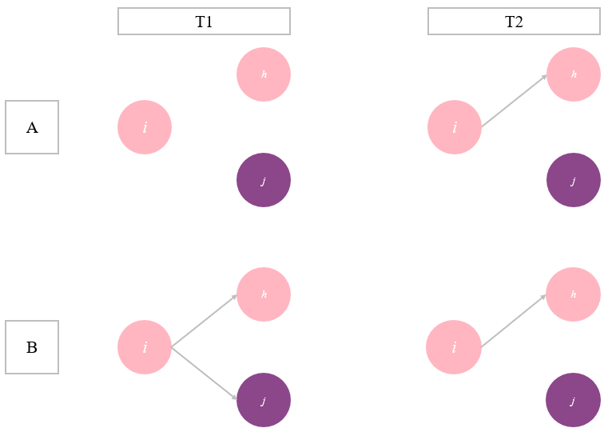
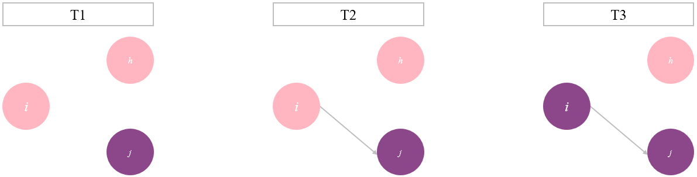
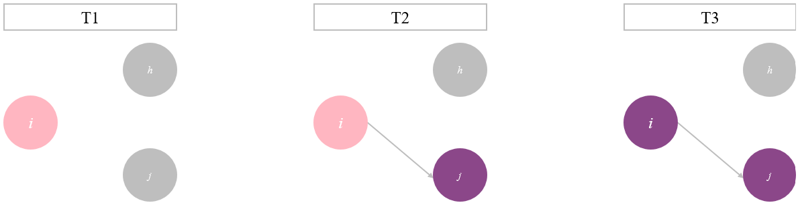

# Theory

Clustering in social networks is characterised by individuals having ties with similar others, and having fewer ties with dissimilar others (SOURCE). That there is clustering within social networks, is a well established fact (SOURCE), networks cluster around gender (SOURCE), ethnicity (SOURCE), political preference (SOURCE), and social economic status (SOURCE), to name a few. Clustering can thus be the result of both visible, and invisible personal characteristics. In the following chapter, an overview of mechanisms of network clustering will be presented, focussing on civic attitudes, specifically focussing on homophily/ preference and social learning/ influence effects.

## Homophily

The core principle of homophily is that similar people prefer each others' company over the company of dissimilar others (SOURCE). This process is visualised in Figure 1. Concretely, this means that people with behavioural attitude A (pink in Figure 1) prefer to make ties with other people with attitude A, rather than with people with attitude B (purple). Because actor *i* and *h* hold similar attitudes, they are more likely to create a tie, than actor *i* and *j* (Figure 1, A). However, homophily does not just take place when making a tie with another person, it also has an effect on what ties remain (SOURCE). Dissimilar people are more likely to break their tie, than people who hold similar opinions (Figure 1, B).

 

**Figure 1.**

*Visualisation of homophily*

{width="466"}

 

People prefer to interact with similar others for multiple reasons. Creating a tie with a similar other, can be easier, simply because you exist in the same social context as each other (SOURCE). In order to make a tie with someone, we need to meet that person, and the people we are able to meet are often similar to ourselves. For example, we meet people at our work or school, but the people we meet there are often similarly educated as we are. This leads to clustering in social networks, even if ego themselves may not be aware of this, nor are they actively choosing to make ties with similar people.

A second reason for homophily is that there can be less conflict between similar people. People with the same attitudes, are easier to befriend, because there are fewer opportunities of conflict, after all, you will not have to fight about the things you already agree on. This can also explain why ties between dissimilar others are broken more often. If there is a lot of conflict between two people, their tie may become weaker and weaker until it breaks. Thus, solely based on selection effects, it can be expected that people have more ties with similar others, than with dissimilar others.

Applied to civic attitudes, this means that people who have relatively disengaged civic attitudes, are more likely to meet and connect with other people who are civilly disengaged, and vice versa.

 

## Social learning

Clustering in social networks can not be explained solely through selection effects. Even if our social contexts exist of relatively similar others, there is still a variation of attitudes and behaviours within this context. Secondly, people can differ from their ties on some aspects, without a breaking tie being inevitable. A second explanation for clustering within social networks is influence effects (SOURCE). This effect assumes that ego makes ties with other regardless of their similarity to the alter. Once the tie is made, ego and alter become more similar to each other. This process is represented in Figure 2.

 

**Figure 2.**

*Visualisation of influence*

 

Influence effects can take place for many reasons. Due to our connection with other people we may come to new insights, and change our attitudes accordingly (SOURCE). Influence effects can also take place, because ego wants to minimise the amount of social disapproval they get from their alters. By changing their attitude or behaviour to match their network's, ego minimises the chances of social conflict.

For civic attitudes this means that a civilly disengaged ego can make a tie with a civilly engaged alter. When these two have a connection, their attitudinal characteristics become more similar to each other. Ego, who is has disengaged civic attitudes, will become more engaged, because they want to fit in with the alter who is civilly engaged. This process can also work the other way around.

Combining the processes of homophily and influence, lead to the expectation of networks being clustered around civic attitudes. According to the homophily principle, students would be more likely to make and keep ties with similar others, and even if they make ties with dissimilar others, influence effects will ensure clustering in the network. Thus, these two principles combined lead to the following hypothesis:

H1: *Students in Michigan learning communities, who are more similar in their civic engagement attitudes are more likely to have ties with one another than with people who differ from them in their attitudes.*

 

Civic attitudes form an interesting behavioural characteristic to look at in light of network clustering, because it is a characteristic that tends to be invisible to until you get to know someone. Civic engagement attitudes is not necessarily an attitude that can be clearly seen in others, before making a connection with them. Figure 3 represents this uncertainty, by showing both alters being grey, as ego cannot know their attitudes. When making a tie, ego thus chooses 'blindly' with whom they want to make a tie. This directly undermines the idea of selection effects, as ego cannot select on civic attitudes when making a tie, while it strengthens the potential effects of influence.

 

**Figure 3.**

*Visualisation of tie-making in uncertain situations, with an influence effect*

 

Once ego and alter make a tie, and they get to know each other better, it becomes clear that they differ in their civic attitudes. Ego can now break the tie, something that would be likely according to the homophily principle, or keep the tie, allowing for influence effects to take place. This paper argues that people are unlikely to break a tie based on differences in civic attitudes. Civic attitudes are often not at the core of a person's identity (SOURCE), making it a less important characteristic when deciding with whom to make and maintain ties. Once people already have a tie, and then find out that they differ in this aspect, ego and alter have already established a relationship, which is likely to remain despite differences in some attitudes. The created tie does open the way for influence effects to take place. Despite civic attitudes not being a core part of their identity, ego can still learn and develop through interactions with alter, thereby changing their attitudes.

Thus, taking both preference and influence effects together, for civic attitudes, this paper expects that influence effects are stronger than preference effects for explaining clustering in social networks. This leads to the following hypothesis:

H2: *The influence effect is stronger than the selection effect for civic engagement attitudes, for students in Michigan learning communities*

------------------------------------------------------------------------

# References
